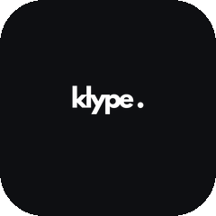

[](https://aiagentslisting.com/mcp/klype-ai-mcp-server)

# Klype AI MCP server

Klype is a voice and context layer for GTM teams. It stores a company's product, buyer and voice context once, measures how a real person writes, and makes every AI-drafted post or message sound like that person before it goes out. Nothing publishes without the owner's approval.

This is the remote MCP server for Klype. Connect it to Claude, ChatGPT, Cursor, n8n or any MCP client and your agents can draft in your voice, check any text against it, and keep an approval record.

- **Endpoint:** `https://api.klype.ai/api/v1/mcp` (Streamable HTTP, JSON-RPC over POST)
- **Auth:** OAuth 2.1 with dynamic client registration (discovery at `https://api.klype.ai/.well-known/oauth-authorization-server`), or a Klype API key (`Authorization: Bearer klp_live_...`)
- **Protocol versions:** 2025-06-18, 2025-03-26, 2024-11-05
- **Server card:** `https://api.klype.ai/.well-known/mcp/server-card.json`

## Tools

| Tool | What it does | Scope | Read-only |
| --- | --- | --- | --- |
| `list_workspaces` | Lists the business workspaces saved in Klype. Each holds one company's product, buyer and voice context. | context:read | yes |
| `get_workspace_context` | Returns the saved product, buyer and voice context for one workspace. | context:read | yes |
| `draft_post` | Drafts a post in the owner's measured voice, grounded in a workspace. Never publishes. | drafts:write | no |
| `review_draft` | Checks any text against the owner's voice, saved facts and rules. Returns a score, a verdict and fixes. | context:read | yes |
| `approve_draft` | Records that the owner approved the checked text. | drafts:write | no |
| `list_approvals` | Returns the owner's approval record. | approvals:read | yes |
| `get_performance_insights` | What has actually performed for the owner, from imported post results. | context:read | yes |

## Connect

**Claude (claude.ai or Claude Desktop):** Settings > Connectors > Add custom connector > paste `https://api.klype.ai/api/v1/mcp` and sign in to Klype.

**Cursor / any client that takes a JSON config:**

```json
{
  "mcpServers": {
    "klype": {
      "url": "https://api.klype.ai/api/v1/mcp",
      "headers": { "Authorization": "Bearer klp_live_YOUR_KEY" }
    }
  }
}
```

Create an API key in Klype at app.klype.ai/dashboard/connections, and pick only the scopes you need.

**Raw HTTP:**

```bash
curl -s https://api.klype.ai/api/v1/mcp \
  -H "Authorization: Bearer klp_live_YOUR_KEY" \
  -H "Content-Type: application/json" \
  -d '{"jsonrpc":"2.0","id":1,"method":"tools/list"}'
```

## REST API

The same capabilities are available as REST under `https://api.klype.ai/api/v1/platform` (`/workspaces`, `/workspaces/{id}/context`, `/drafts`, `/review`, `/review/{id}/fix`, `/review/{id}/approve`, `/insights`, `/approvals`). Interactive docs: `https://api.klype.ai/api/docs`.

## Limits

360 MCP calls per hour per key (about 120 drafts). Draft generation draws on the account's Klype credits.

## Links

- Website: https://klype.ai
- App: https://app.klype.ai
- Support: shruti@klype.ai

## Listed in

- [Official MCP Registry](https://registry.modelcontextprotocol.io) as `ai.klype/klype`
- [Glama](https://glama.ai/mcp/servers)
- [Smithery](https://smithery.ai)
- Listed in the [Claude Market MCP directory](https://www.claudemarket.ai/mcp)

This repository documents the hosted server. The server itself runs at `https://api.klype.ai/api/v1/mcp`; there is nothing to install.

